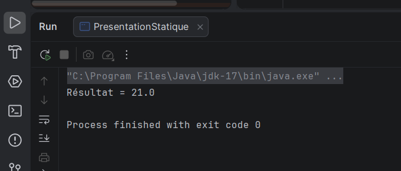
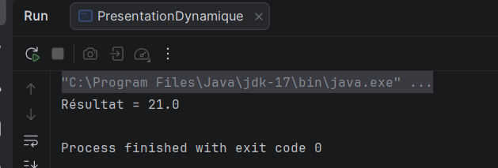
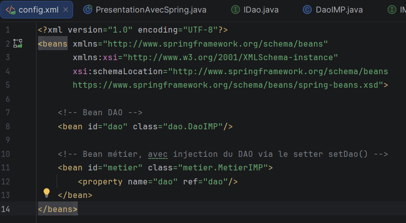
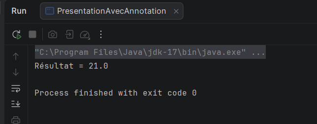

# TP1 — Inversion de Contrôle (IoC) et Injection de Dépendances (DI)

## Informations générales

- **Établissement :** Faculté des Sciences de Sfax
- **Matière :** Architecture MicroServices
- **Formation :** MPSRCC1
- **Année universitaire :** 2026–2027
- **Enseignantes :** Corinne Amel Zayani et Amal Abid
- **Étudiante :** [Fatma Cherif]

---

## 1. Objectifs du TP

Ce TP a pour objectif de comprendre les concepts d'injection de dépendances (DI) et d'inversion de contrôle (IoC), en utilisant Java, Maven et le framework Spring.

Les quatre activités permettent d'étudier différentes façons de créer des objets et de gérer leurs dépendances :

1. Injection de dépendances par instanciation statique.
2. Instanciation dynamique à partir d'un fichier de configuration.
3. Injection de dépendances avec Spring et un fichier XML.
4. Injection de dépendances avec les annotations Spring.

## 2. Environnement de travail

- Java JDK 17
- IntelliJ IDEA
- Maven
- Spring Framework 6.2.8
- Git et GitHub

Le projet Maven contient trois packages principaux : `dao`, `metier` et `presentation`. Les fichiers de configuration sont placés dans `src/main/resources`.

## 3. Structure du projet

```text
TP1-IoC-DI/
├── pom.xml
├── README.md
├── captures/
│   ├── 01-instanciation-statique.png
│   ├── 02-configuration-dynamique.png
│   ├── 03-instanciation-dynamique.png
│   ├── 04-configuration-spring-xml.png
│   ├── 05-spring-xml-execution.png
│   ├── 06-annotations-spring.png
│   └── 07-spring-annotations-execution.png
└── src/
    └── main/
        ├── java/
        │   ├── dao/
        │   │   ├── IDao.java
        │   │   └── DaoIMP.java
        │   ├── metier/
        │   │   ├── IMetier.java
        │   │   └── MetierIMP.java
        │   └── presentation/
        │       ├── PresentationStatique.java
        │       ├── PresentationDynamique.java
        │       ├── PresentationAvecSpring.java
        │       └── PresentationAvecAnnotation.java
        └── resources/
            ├── config.txt
            └── config.xml
```

## 4. Concepts étudiés

### 4.1. Injection de dépendances (DI)

L'injection de dépendances consiste à fournir à une classe les objets dont elle a besoin, au lieu de lui faire créer elle-même ces objets.

Dans ce TP, `MetierIMP` utilise une dépendance de type `IDao` pour récupérer une valeur et effectuer un calcul.

### 4.2. Inversion de contrôle (IoC)

L'inversion de contrôle consiste à transférer à un conteneur ou à un mécanisme externe la responsabilité de créer et d'assembler les objets.

Avec Spring, le conteneur gère la création des beans et l'injection de leurs dépendances.

### 4.3. Couplage faible

La classe métier dépend de l'interface `IDao`, plutôt que directement de la classe `DaoIMP`. Cela facilite le remplacement de l'implémentation du DAO sans modifier la logique métier.

## 5. Activité 1-1 — Instanciation statique

### Objectif

Explorer le couplage faible en utilisant l'injection de dépendances par instanciation statique.

### Réalisation

La classe `PresentationStatique` crée une instance de `DaoIMP` et une instance de `MetierIMP`. Elle transmet ensuite le DAO à la classe métier à l'aide de la méthode `setDao()`.

La méthode `getValue()` retourne `3`. La méthode `calcul()` multiplie cette valeur par `7`.

### Capture d'écran



### Résultat attendu

```text
21.0
```

### Analyse

Le couplage est réduit grâce à l'utilisation de l'interface `IDao`. Toutefois, la classe de présentation crée encore explicitement les objets avec `new`. La création des objets n'est donc pas entièrement déléguée à un conteneur IoC.

## 6. Activité 1-2 — Instanciation dynamique

### Objectif

Charger les classes à partir des noms définis dans un fichier de configuration.

### Réalisation

Le fichier `config.txt` contient les noms complets des classes à charger :

```text
dao.DaoIMP
metier.MetierIMP
```

La classe `PresentationDynamique` lit ces noms, utilise `Class.forName()` pour charger les classes et la réflexion pour créer les instances. Elle injecte ensuite le DAO dans la classe métier en invoquant la méthode `setDao()`.

### Captures d'écran



### Résultat attendu

```text
21.0
```

### Analyse

Cette approche permet de modifier les classes utilisées en changeant le fichier de configuration, sans modifier le code de présentation, si les nouvelles classes respectent les contrats attendus.

Cependant, le code de présentation reste responsable du chargement, de la création et de l'assemblage des objets.

## 7. Activité 1-3 — Injection avec Spring XML

### Objectif

Utiliser Spring et un fichier XML pour gérer les beans et leurs dépendances.

### Réalisation

Le fichier `config.xml` déclare deux beans : `dao` et `metier`. La propriété `dao` du bean métier référence le bean DAO. Spring utilise le setter `setDao()` pour injecter la dépendance.

La classe `PresentationAvecSpring` charge le contexte avec `ClassPathXmlApplicationContext`, récupère le bean métier puis exécute son calcul.

### Captures d'écran




### Résultat attendu

```text
21.0
```

### Analyse

Le conteneur Spring lit le fichier XML, crée les objets et assemble leurs dépendances. La classe de présentation n'a plus besoin de créer manuellement les instances.

Cette solution applique l'inversion de contrôle grâce à la délégation de la création et de l'assemblage au conteneur Spring.

## 8. Activité 1-4 — Injection avec les annotations Spring

### Objectif

Découvrir l'injection de dépendances avec les annotations Spring.

### Réalisation

Les annotations utilisées sont :

- `@Repository` sur `DaoIMP` pour identifier la couche d'accès aux données.
- `@Service` sur `MetierIMP` pour identifier la couche métier.
- `@Autowired` sur l'attribut `dao` pour demander l'injection automatique de la dépendance.

La classe `PresentationAvecAnnotation` crée un contexte Spring en scannant les packages `dao` et `metier`, puis récupère le bean implémentant `IMetier`.

### Captures d'écran




### Résultat attendu

```text
21.0
```

### Analyse

Spring détecte les classes annotées, crée les beans correspondants et injecte automatiquement le DAO dans la classe métier.

Cette approche évite de déclarer individuellement les beans dans le fichier XML et rend la configuration plus proche du code.

## 9. Comparaison des quatre approches

| Activité | Mécanisme | Gestion des dépendances |
|---|---|---|
| 1-1 | `new` et setter | Manuelle dans la présentation |
| 1-2 | `Class.forName()` et réflexion | Dynamique, pilotée par le programme |
| 1-3 | Configuration XML | Gérée par le conteneur Spring |
| 1-4 | Annotations Spring | Gérée par le conteneur Spring |

L'évolution entre les quatre activités montre le passage d'une création manuelle des objets à une gestion des dépendances déléguée au conteneur Spring.

## 10. Conclusion

Ce TP m'a permis d'étudier le couplage faible, l'injection de dépendances et l'inversion de contrôle. Les deux premières activités reposent sur une création manuelle ou dynamique des objets. Les activités utilisant Spring permettent de déléguer au conteneur la création des beans et l'assemblage de leurs dépendances.

La configuration XML et les annotations représentent deux approches différentes pour configurer Spring. Les annotations permettent notamment de déclarer les composants directement dans le code.

---

**Remarque :** les résultats et les captures présentés dans ce compte rendu doivent correspondre aux exécutions réelles du projet.

